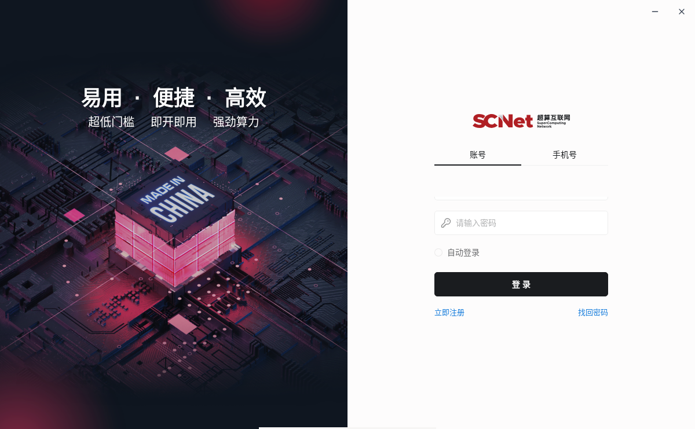

# scnet-client-linux

**Unofficial Linux x64 port of the SCNet desktop client** (应用名「计算服务」,
bundle id `com.sugon.sacp`). Takes the official macOS Electron build and swaps the
platform-specific pieces, producing a runnable portable directory and a
Debian/Ubuntu package.

> This repository contains **no vendor binaries and no build outputs** — only
> scripts, docs and a screenshot. The vendor archive is fetched from the
> official CDN at build time; make sure that is acceptable in your situation.



## Status

Works and has been exercised end to end (Debian 13 x64, X11): main process,
preload, renderer and all native modules come up, the UI is fully functional.

- Upstream: SCNet Client **4.1.0**, Electron **44.7.0**
- Output: `build/linux/` (portable) + `scnet-client_4.1.0_amd64.deb`
- Config stays where macOS/Windows put it: `~/.sclaw/`

The vendor only publishes Windows/macOS/Android builds, but the app is
cross-platform code with Linux branches already present — it was never packaged.

## Build

A prebuilt `scnet-client_4.1.0_amd64.deb` is attached to
[Releases](https://github.com/lql341/scnet-client-linux/releases) (it contains the
vendor client itself, unsigned — personal use / evaluation only; checksums are
on the release page).

From source:

Requirements: `bash curl unzip python3 nodejs npm gcc g++ make dpkg-deb fakeroot`.

```bash
./build-linux.sh                                  # download → swap → package
./build/linux/launcher.sh                         # run the portable build
sudo apt install ./scnet-client_4.1.0_amd64.deb   # or install the deb
```

The script is idempotent; downloads and rebuilds are cached under `build/`.
It verifies the vendor archive against the SHA-512 published in
`latest-mac.yml` and self-checks that every Linux native artifact landed before
packaging.

## What gets replaced

| Component | In the macOS build | Linux replacement |
| --- | --- | --- |
| Electron runtime | 44.7.0 darwin | `electron-v44.7.0-linux-x64.zip` |
| `node-pty` | `prebuilds/darwin-*` | compiled against Electron 44.7.0 headers |
| `@napi-rs/canvas` | `canvas-darwin-*` | `@napi-rs/canvas-linux-x64-gnu@1.0.2` |
| `@trycua/cua-driver` | `cua-driver-darwin-*` | `@trycua/cua-driver-linux-x64-gnu@0.34.1` |
| `@ubjs/node` | `node-darwin-*` | `@ubjs/node-linux-x64-gnu@0.31.0-3` |
| `agent-browser` | Mach-O 0.39.0 | `bin/agent-browser-linux-x64` from the same npm version |
| `resources/bin/uv` | Mach-O | uv 0.9.9 static Linux binary |
| `ssh2` native accel | `sshcrypto.node` (darwin) | omitted; ssh2 falls back to pure JS |
| `app.asar` | partially unpacked | repacked with `--unpack-dir node_modules` |
| Icon / entry | `icon.icns` | 1024 px PNG extracted from icns + `.desktop` + launcher |

Not a single line of JavaScript inside `app.asar` was modified.

The launcher keeps Chromium's sandbox whenever it can (setuid `chrome-sandbox`
or unprivileged user namespaces, including the AppArmor restriction on Ubuntu
23.10+) and only falls back to `--no-sandbox` otherwise. `SCNET_NO_SANDBOX=1`
forces the fallback.

## Verified / not verified

Verified: window titled 「计算服务」 (1200×741) with a complete UI; sessions,
skills, `home-scenarios` and `~/.sclaw` read/write; native smoke tests for
`node-pty` (spawn), `@napi-rs/canvas`, `ssh2`, `@ubjs/node` and
`@trycua/cua-driver` (Rust `.so` via `dlopen`); `uv` and `agent-browser`
executables; the same after unpacking the `.deb`.

Not verified / known limits: no login, HPC submit, SSH session or file-transfer
regression run yet; computer-use (CUA) loads but clicking/screenshotting is
untested and needs X11/Wayland access plus `libXtst`; auto-update cannot work
(the feed is macOS-only, and electron-updater cannot replace a Linux bundle) —
upgrade by rerunning the script; no code signing; unofficial, unsupported by the
vendor.

## Docs

- [docs/analysis.md](docs/analysis.md) — package layout, distribution feeds, why Linux works (with code evidence)
- [docs/packaging.md](docs/packaging.md) — asar repacking, native ABI, deb layout, upgrade checklist, FAQ

## Disclaimer

Not affiliated with, endorsed by, or supported by 曙光智算 / SCNet.
No vendor code or binaries are redistributed here; build outputs are generated
locally from the vendor's own distribution. You are responsible for compliance.

## License

Scripts and docs: MIT — see [LICENSE](LICENSE). The upstream client remains the
property of its owners and is not covered by this license.
