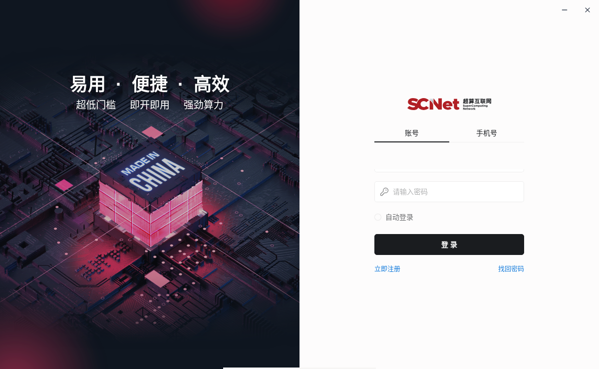

# scnet-client-linux

非官方的 **SCNet 客户端（应用名「计算服务」）Linux x64 移植构建脚本**。
从官方 macOS Electron 包出发，替换掉平台相关的二进制与原生模块，产出可运行的
便携目录和 Debian/Ubuntu 安装包。

[English](README.en.md)

> 仓库**不包含**任何厂商二进制或构建产物，只包含脚本、文档和截图。
> 构建时由脚本从官方 CDN 下载 `SCNet-<version>-x64.zip`，请自行确认这样做
> 符合你所在地区/场景对官方客户端的使用约定。



## 结论

可行，且已实际跑通（Debian 13 x64 + X11）：主进程 / 渲染进程 / 原生模块全部正常，
界面功能完整。官方只发布 Windows、macOS、Android，没有 Linux 包；但客户端本身是
跨平台代码，Linux 分支是现成的，只是从未打包。

- 上游版本：SCNet Client **4.1.0**（`com.sugon.sacp`），Electron **44.7.0**
- 构建产物：`build/linux/`（便携目录）+ `scnet-client_4.1.0_amd64.deb`
- 配置落点与 macOS/Windows 一致：`~/.sclaw/`

## 快速开始

预构建的 `scnet-client_4.1.0_amd64.deb` 见 [Releases](https://github.com/lql341/scnet-client-linux/releases)
（含厂商客户端本体、未签名，仅个人使用/评估；校验和也在 release 页）。
从源码构建：

依赖：`bash curl unzip python3 nodejs npm gcc g++ make dpkg-deb fakeroot`（Debian/Ubuntu 均可装齐）。

```bash
./build-linux.sh                     # 全流程：下载官方包 → 替换 → 打包
./build/linux/launcher.sh            # 直接运行便携版
sudo apt install ./scnet-client_4.1.0_amd64.deb   # 或安装 deb 后从菜单启动
```

脚本是幂等的：中间产物缓存在 `build/cache/`、`build/work/`，重复执行只重建变化的部分；
下载会用 `latest-mac.yml` 里的 SHA-512 校验，打包前还会自检 6 个必需的 Linux 原生产物。

启动器会尽量保留 Chromium 沙箱（setuid `chrome-sandbox` 或非特权 user namespace，
包括 Ubuntu 23.10+ 的 AppArmor 限制），只有两者都不可用时才退化为 `--no-sandbox`；
`SCNET_NO_SANDBOX=1` 可强制退化。

产物布局：

```
build/linux/
├── scnet-client                  Electron 44.7.0 Linux 运行时
├── launcher.sh                   启动器（无 setuid sandbox 时自动 --no-sandbox）
└── resources/
    ├── app.asar                  重新打包的上游 asar（JS 未改动）
    ├── app.asar.unpacked/        全部 node_modules（含 Linux 原生模块）
    ├── bin/uv                    uv 0.9.9 Linux 静态二进制
    ├── agent-browser/             agent-browser 0.39.0 Linux 二进制
    └── agent-skills/ agent-plugins/ connectors/ home-scenarios/ cli/ cua/
```

## 换了哪些东西

| 部件 | macOS 包内 | Linux 版替换 |
| --- | --- | --- |
| Electron 运行时 | 44.7.0 darwin | `electron-v44.7.0-linux-x64.zip` |
| `node-pty` | `prebuilds/darwin-*` | 按 Electron 44.7.0 头文件源码编译 `prebuilds/linux-x64/pty.node` |
| `@napi-rs/canvas` | `canvas-darwin-*` | `@napi-rs/canvas-linux-x64-gnu@1.0.2` |
| `@trycua/cua-driver` | `cua-driver-darwin-*` | `@trycua/cua-driver-linux-x64-gnu@0.34.1` |
| `@ubjs/node` | `node-darwin-*` | `@ubjs/node-linux-x64-gnu@0.31.0-3` |
| `agent-browser` | Mach-O 0.39.0 | npm 包内 `bin/agent-browser-linux-x64` |
| `resources/bin/uv` | Mach-O | uv 0.9.9 Linux 静态二进制（PyPI wheel） |
| `ssh2` 原生加速 | `sshcrypto.node` (darwin) | 不提供；ssh2 自动回退纯 JS 实现 |
| `app.asar` | 部分 node_modules unpacked | 重打包 + `--unpack-dir node_modules` |
| 图标 / 入口 | `icon.icns` | 从 icns 提取 1024px PNG + `.desktop` + launcher |

`app.asar` 内的 JavaScript 一行未改。

## 已验证 / 未验证

已验证：

- 主进程、preload、渲染进程正常启动，窗口标题「计算服务」，1200×741，界面完整；
- 会话、skills、`home-scenarios`、`~/.sclaw` 读写正常；
- 原生模块冒烟测试全部通过：`node-pty`（spawn `/bin/echo`）、`@napi-rs/canvas`、
  `ssh2`、`@ubjs/node`、`@trycua/cua-driver`（Rust `.so` 从 `app.asar.unpacked` 加载成功）；
- `resources/bin/uv`、`resources/agent-browser/agent-browser` 可执行且版本正确；
- deb 解包后同样能启动。

未验证 / 已知限制：

- 未做联网登录、HPC 作业提交、SSH 会话、文件传输的完整回归；
- 电脑操作（CUA）：库可加载，但未实测点击/截图，且依赖 X11/Wayland 权限与 `libXtst` 等运行时；
- 自动更新不可用：`app-update.yml` 指向 macOS feed，electron-updater 也无法在 Linux 上
  替换包体；升级只能重跑本脚本（见 `check-upstream.sh`）；
- 没有代码签名/公证；
- 非官方构建，SCNet 不提供支持；若官方发布 Linux 版，请改用官方包。

## 文档

- [docs/analysis.md](docs/analysis.md) — 客户端内部结构、分发源、为什么 Linux 可行（含代码证据）
- [docs/packaging.md](docs/packaging.md) — asar 重打包、原生模块 ABI、deb 布局、升级流程

## 免责声明

本项目与 曙光智算 / 国家超算互联网（SCNet）无关，未获其授权或认可。
仓库中不含厂商代码或二进制，构建产物由你在本地从官方分发包生成，请自行承担合规责任。

## License

仓库内脚本与文档：MIT（见 [LICENSE](LICENSE)）。
上游客户端软件版权归其权利人所有，不受本仓库许可影响。
